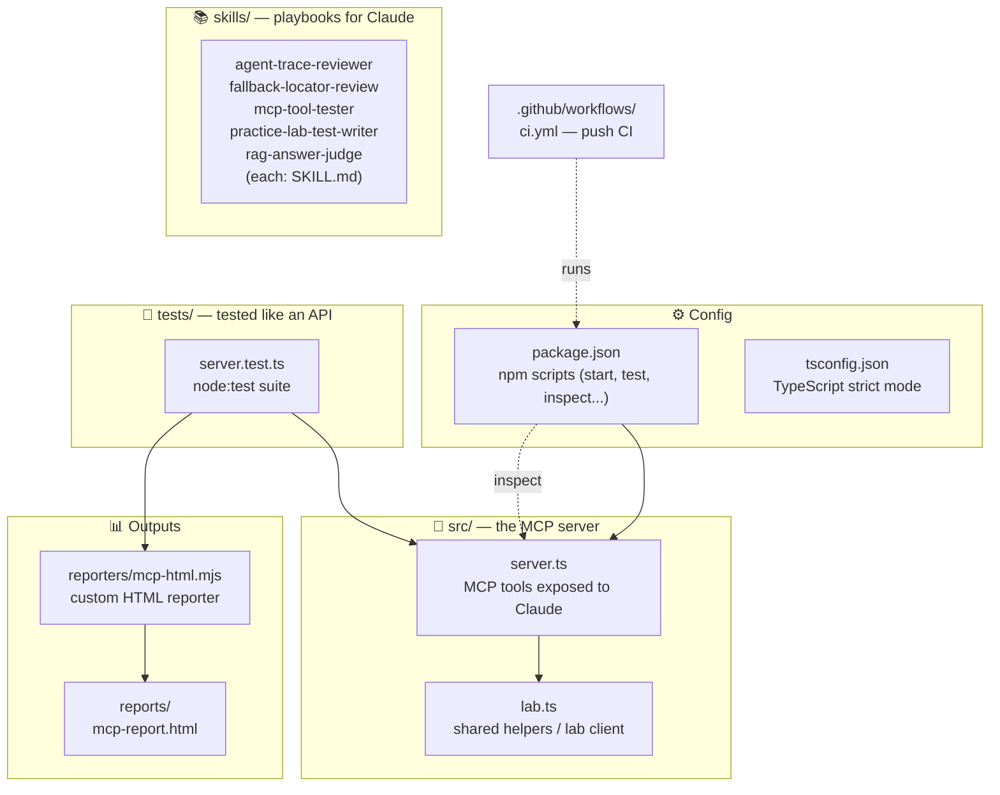

# Architecture

How this repo's folders fit together. The core is an **MCP server** (`src/`) that exposes tools for Claude. You test it like any API with a **test suite** (`tests/`) that spins the server up in-process, and a custom **reporter** turns the results into a shareable HTML report. Alongside the code live a set of **skills** — Markdown playbooks a tester hands to Claude. CI runs the typecheck and tests on every push.

## Every folder, top to bottom

| Folder / file | What it is | Why it's here |
|---|---|---|
| `src/` | The MCP server. `server.ts` defines the tools exposed to Claude; `lab.ts` holds shared helpers / the lab client it calls. | The thing under test — run it with `npm start`, poke it with `npm run inspect`. |
| `tests/` | `server.test.ts` — a `node:test` suite that drives the server in-process and asserts each tool's behavior. | Proves the MCP tools behave like a well-tested API. Run with `npm test`. |
| `skills/` | Five skill folders, each a `SKILL.md`: `agent-trace-reviewer`, `fallback-locator-review`, `mcp-tool-tester`, `practice-lab-test-writer`, `rag-answer-judge`. | Reusable Markdown playbooks a tester gives to Claude for a specific review or authoring task. |
| `reporters/` | `mcp-html.mjs` — a custom `node:test` reporter. | Turns raw test output into the shareable HTML report. |
| `reports/` | `mcp-report.html` from `npm run test:report` (git-ignored). | The **share** view of a run for people who don't read the terminal. |
| `.github/workflows/` | `ci.yml`. | Runs the typecheck and tests on every push. |
| `package.json` | The `npm run ...` scripts: `start`, `inspect`, `test`, `test:report`, `typecheck`. | The entry points — every workflow in this repo is a named script. |
| `tsconfig.json` | TypeScript strict-mode settings. | `npm run typecheck` checks every file against it. |

> **Build outputs vs. source.** `reports/` is generated and git-ignored; it appears only after `npm run test:report`. The folders you *edit* are `src/`, `tests/`, `skills/` and `reporters/`.
